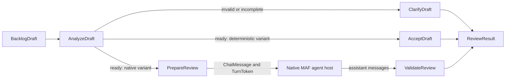

# Typed workflows and native agents

> Historical acceptance scripts and reports are kept in the author's local reserve and are not included in this repository. Use the root README for build/test commands and the demo READMEs for current launch commands.

Current paths were updated for Lot-016. Use the [stable demo catalogue](../DemoCatalog.md) and [course map](../CourseMap.md); dated receipts retain their original paths.

The three Video2 copies now share the backlog vocabulary and the Lot-005 `BacklogDraft` contract. The original B2B examples, films and slides remain historical references. This is an explicit scenario change: the graph reviews an existing host-supplied backlog draft; it does not classify free text, create a backlog row or approve a write.

## Run the progression

From `BaseTechnique`, restore and build with `dotnet build BaseTechnique.slnx -m:1 -c Release; dotnet test BaseTechnique.slnx -m:1 -c Release --no-build --no-restore`. All explicit `dotnet build` and `dotnet test` commands must include `-m:1`.

```powershell
dotnet run --project 'demos/Demo230_TypedWorkflow' --configuration Release --no-build
dotnet run --project 'demos/Demo230_TypedWorkflow' --configuration Release --no-build -- --incomplete
dotnet run --project 'demos/Demo240_AgentWorkflow' --configuration Release --no-build
dotnet run --project 'demos/Demo250_WorkflowEvents' --configuration Release --no-build
# Archived acceptance recipe: tools/Verify-Lot008.ps1
```

All three entry points also accept `--invalid` (unknown component) and `--incomplete` (a pending clarification). Both produce an explicit `NeedsClarification` terminal output. They do not throw as part of normal routing, silently stop on a missing edge, or call the model. Each command runs once and exits even with closed stdin. Model failure, missing terminal output and rejected model output return exit code 1.

The second and third examples load the common `ai-settings.json` relative to the executable, then environment variables and explicit `--AI:...` arguments. Ollama `granite4:3b` is the default. The second mode uses `--AI:ChatProvider OpenAICompatible --AI:ApiChat:Model <model>` and the secret environment variable configured by the common connection module. There is no automatic cloud fallback. The smoke script pins localhost Ollama and never selects the paid API. Embeddings are not needed by this scenario.

## Messages, executors and branching

| Boundary | Type | Responsibility |
|---|---|---|
| Host -> AnalyzeDraft | `BacklogDraft` | Supply a complete typed fixture; copy its mutable questions array |
| AnalyzeDraft -> branch | `DraftDecision` | Call the shared `Validate()`; route on the computed `IsReady` |
| Invalid/incomplete -> ClarifyDraft | `DraftDecision` | Return validation errors and pending questions |
| Ready -> AcceptDraft | `DraftDecision` | Deterministic variant: return `Ready` without a model |
| Ready -> PrepareReview | `DraftDecision` | Native variant: retain the expected host snapshot, send JSON `ChatMessage` and `TurnToken` |
| Agent host -> ValidateReview | `List<ChatMessage>` | Deserialize assistant JSON, validate business rules and compare all facts with the snapshot |
| Terminal executors -> caller | `ReviewResult` | Return `Ready`, `Reviewed`, `NeedsClarification` or `Rejected` |



`Executor<TInput,TOutput>` declares the simple message protocol. `PrepareReview` sends two types explicitly and declares both with `SendsMessage`. MAF validates that protocol; an undeclared send becomes a workflow error. Conditions are mutually exclusive and cover every `DraftDecision`.

`BacklogWorkflow.Build` creates fresh executors. Build a fresh graph for each independent input, as the supplied runner does. `PrepareReview` holds a run-local expected snapshot; this example is not a reusable concurrent workflow service and does not serialize that field for checkpoints. Durable state and external decisions belong to Lot-009.

## Native agent integration in MAF 1.26.0

`CreateReviewer` builds a real `ChatClientAgent`, using the common connection and a `BacklogDraft` JSON schema. `BindAsExecutor` adapts it to MAF's native agent host. This replaces the old custom executor calling `IChatClient.GetResponseAsync` directly. The native host creates and manages its agent session.

The agent host first caches the incoming chat message. It runs the agent when `TurnToken` arrives. Consequently, two `ExecutorInvokedEvent` entries for the same agent host can represent **one model call**. The scripted-client test asserts exactly one call. `ForwardIncomingMessages=false` prevents the user JSON from being passed downstream as though it were generated assistant output. `EmitAgentResponseEvents=true` exposes the raw response for observation. It is not the accepted business output. Agent token streaming is explicitly disabled here; workflow events still stream.

The final executor rejects malformed/empty/null JSON, invalid domains and any changed title, kind, priority, component, summary or questions. No model text proves a write occurred. No write tools are exposed. `Reviewed` means that the returned contract passed these checks; it does not establish a model's semantic understanding or perform approval.

This deliberately strict round-trip example teaches the native binding and trust boundaries. Copying an already valid draft does not require a model in a real application. A richer linguistic transformation would need a separate output contract and corresponding semantic checks.

The current [Microsoft agent executor documentation](https://learn.microsoft.com/en-us/agent-framework/concepts/workflows/advanced/agent-executor) explains the native binding and turn token pattern. The implementation was also checked against the installed 1.26.0 XML API documentation, and executed against that pinned package. Historical RC2 statements in reference slides do not define the capabilities of this baseline.

## Planned graph, executed path and telemetry

The planned graph lists possible edges. The executed path is collected from actual `ExecutorInvokedEvent` events, preserving repeated deliveries. For an incomplete request it is exactly `AnalyzeDraft -> ClarifyDraft`; the ready native route includes `PrepareReview`, two deliveries to the generated `BacklogReviewer_<id>` executor and `ValidateReview`. Executor IDs contain a generated suffix; do not compare complete IDs between processes.

The third example prints lifecycle and superstep event names while consuming the entire stream. It does not return early at the first output and lose later events. Only a `WorkflowOutputEvent` carrying `ReviewResult` is treated as terminal business evidence. `AgentResponseEvent` remains unvalidated observation.

It also enables native workflow instrumentation using `WithOpenTelemetry()` and records real `Activity` spans from `Microsoft.Agents.AI.Workflows`: operation, source, trace ID, span ID, parent span ID and duration. Sensitive data collection stays disabled. A local `ActivityListener` captures the spans; there is no external collector/exporter to install. The final evidence JSON keeps spans, event names, invocation path, business results and errors separate. Spans explain timings and causal relationships; they do not replace validation, stored-row evidence or human approval. Collector setup, usage accounting and cross-service instrumentation remain later-lot work.

## Choosing an execution model

| Choice | Appropriate use | Example in this base |
|---|---|---|
| Function or ordinary C# orchestration | Few fixed rules, no need for a graph execution model | EP002 discount and explicit routing |
| Native workflow | Explicit typed boundaries, conditional paths, common execution events and instrumentation | Video2 progression |
| Agent loop | Model chooses how to use tools for an open-ended task; host still controls authorization | Lot-005 tool/approval demonstrations |
| Model-produced JSON plan | Data describing proposed steps; it needs a separately controlled interpreter | J2 Lab05 variants; not a native workflow by themselves |

Use the simplest model that satisfies the requirement. A workflow does not require an LLM, and placing an agent in a graph does not make model output deterministic.

## Exercise and verification

1. Run the deterministic ready and incomplete cases. Predict the selected edge before reading the output.
2. Change the priority to an unsupported value in the host fixture. It must terminate through clarification before any agent call.
3. Run the native example and identify the raw agent response versus the accepted `ReviewResult`.
4. In the scripted tests, return a valid draft with a changed priority. It must be rejected despite valid JSON and valid domain values.
5. Run observability with `--incomplete` and compare its planned graph, two-executor invocation path and telemetry spans.

The corresponding checks are implemented in `Maf.Workflows.Tests`; `Verify-Lot008.ps1` runs the nine CLI cases in separate processes from the temporary directory. It checks exact clarification paths, native ready paths, exactly one business output, exit codes, lifecycle events and nonempty telemetry. The script does not prove the number of provider calls; the deterministic native-host test does. See Reception.md (unpublished local archive) for the actual results and limits.
